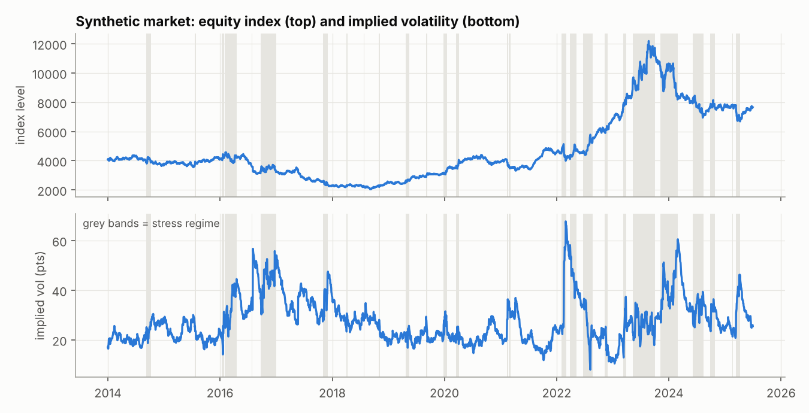
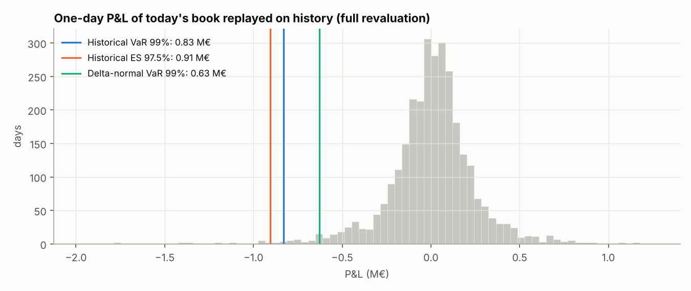
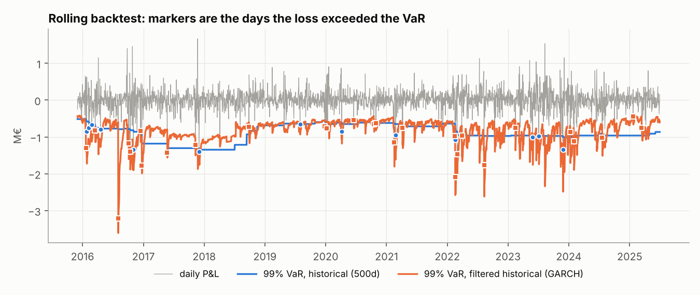
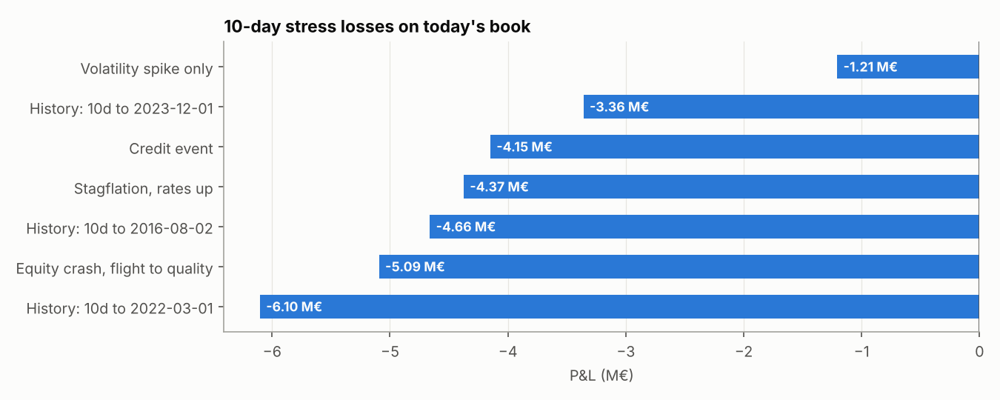
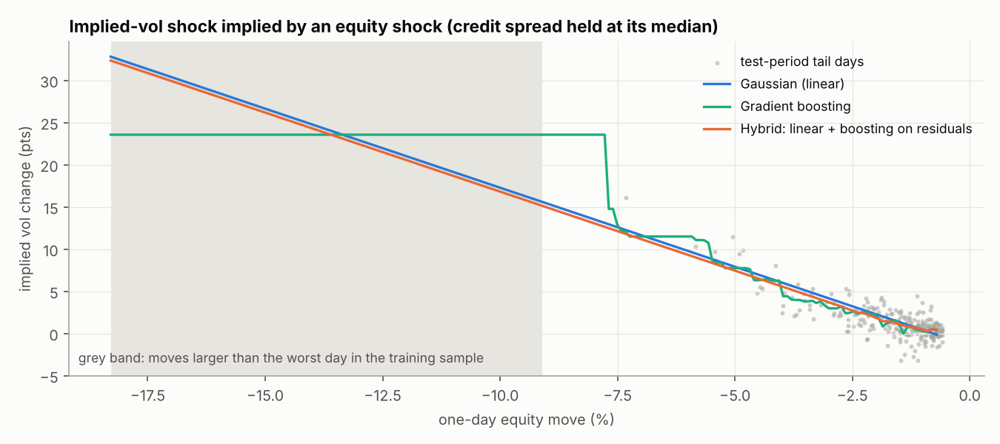

# market-stress-lab

A small market-risk lab in Python: VaR and Expected Shortfall with several methods, a backtest of those VaRs, hypothetical and historical stress tests, a reverse stress test, and a comparison of ways to calibrate the secondary shocks of a scenario, including machine learning.

I built it during my M2 Economics of Global Risks at Toulouse School of Economics to put the risk-measurement material from class into working code. Everything runs on a synthetic market (so the repo needs no data subscription), and the same pipeline accepts real data through a CSV loader.

```bash
pip install -r requirements.txt
python scripts/run_demo.py      # figures in reports/figures, numbers in reports/results.md
python -m pytest                # 19 tests
```

## The book

Five risk factors, simulated daily for about 12 years: an equity index, the 10-year yield, a credit spread, EUR/USD and equity implied volatility. The market switches between a calm and a stress regime (a two-state Markov chain); in stress, volatilities rise, equities and yields fall together and spreads widen. Innovations are Student-t. Implied vol reacts to equity moves through a leverage term plus a convex term, so a crash lifts vol more than proportionally.



The portfolio is long equities, a government bond (duration and convexity), credit (CS01) and USD, and short index puts priced with Black-Scholes. The short puts make the loss accelerate in a sell-off and lose money when vol rises, which is what separates the VaR methods below.

## What the code does and what came out

All numbers are in EUR for the default seed. Full tables: [reports/results.md](reports/results.md).

**VaR and ES.** The one-day 99% VaR is about 0.83 M€ with historical full revaluation and 0.63 M€ with delta-normal. The linear approximation misses the convexity of the short puts and the fat tails. Two things I did not expect:

- Cornish-Fisher gives 1.56 M€. With an excess kurtosis this large, the expansion overshoots badly; it is only reliable close to normality.
- The 97.5% ES and the 99% VaR are almost equal under the normal (0.628 vs 0.625 M€), which is why FRTB could swap one for the other. Under historical simulation they differ (0.91 vs 0.83 M€) because of the tail.



**Backtest.** 2,500 out-of-sample days, 500-day rolling window, 25 exceptions expected at 99%.

| Model | Exceptions | Kupiec p-value | Christoffersen (cond. coverage) p-value |
|---|---|---|---|
| Normal | 59 | 0.000 | 0.000 |
| Historical | 33 | 0.125 | 0.065 |
| Filtered historical (GARCH) | 28 | 0.554 | 0.514 |

The normal VaR fails both tests. The plain historical VaR passes on the count, but its conditional-coverage p-value is borderline (0.065): a 500-day window adapts slowly, so exceptions bunch together after a regime change. The filtered historical simulation rescales the residuals by today's GARCH volatility and passes both. The GARCH(1,1) is written from scratch and estimated by maximum likelihood.



**Stress tests.** Four hypothetical 10-day scenarios (equity crash with flight to quality, stagflation, credit event, vol spike), the worst historical 10-day windows replayed on today's book, and a reverse stress test. The scenarios are my own choices, picked to be internally consistent; they do not come from a regulator.



The reverse stress test answers the question the other two cannot: what is the most plausible move that costs us X? It minimises the Mahalanobis distance of the shock, under a stressed covariance (the most volatile year for this book, as in a stressed VaR), subject to the full-revaluation loss reaching X. For a 4 M€ loss the answer is roughly an equity log-return of -0.18 (about -16%), spreads +32 bp and implied vol +18 points, 3.5 standard deviations away in Mahalanobis terms. The linear closed form is used as the starting point and as a test case.

**Shock calibration.** A scenario usually starts from a few shocks someone writes down ("equities -25%, spreads +150 bp"). The other factors still need values. I compare four ways to fill them in, trained on the tail of the first 70% of the sample and scored on the tail of the last 30%:

| | IR (bp) | FX | VOL (pts) |
|---|---|---|---|
| 1-day, no shock | 7.21 | 0.008 | 2.73 |
| 1-day, Gaussian conditional mean | 6.53 | 0.008 | 1.43 |
| 1-day, gradient boosting | 6.82 | 0.008 | 1.35 |
| 1-day, hybrid | 6.55 | 0.008 | 1.37 |
| 10-day, no shock | 23.54 | 0.023 | 9.62 |
| 10-day, Gaussian conditional mean | 20.04 | 0.023 | 5.27 |
| 10-day, gradient boosting | 20.71 | 0.025 | 5.84 |
| 10-day, hybrid | 19.85 | 0.024 | 5.20 |

(RMSE, lower is better.) Gradient boosting picks up the convex vol response at one day, but it cannot extrapolate: beyond the largest move in the training sample its prediction goes flat, and a stress scenario lives exactly there. The chart shows it. The hybrid model (the Gaussian rule plus boosting on its residuals) keeps the linear extrapolation and is the best or close to it in both horizons. At 10 days the convexity mostly averages out and the linear rule is hard to beat.



## Layout

```
stresslab/
  data.py         synthetic regime-switching market, CSV loader
  pricing.py      Black-Scholes prices and greeks
  portfolio.py    the book, full revaluation, finite-difference sensitivities
  garch.py        GARCH(1,1) by maximum likelihood
  var.py          historical, normal, Cornish-Fisher, delta-normal, Monte Carlo, FHS
  backtest.py     Kupiec, Christoffersen, Basel traffic light, rolling engine
  stress.py       scenarios, historical replay, stressed period, reverse stress test
  calibration.py  Gaussian, gradient boosting and hybrid calibrators
scripts/run_demo.py
tests/
```

## Real data

`stresslab.load_csv` expects daily levels with columns `date, equity, yield_10y, credit_spread, eurusd, implied_vol`. Free sources: the ECB Data Portal for euro-area yields, FRED for VIX and corporate spreads, Stooq for index levels. Then:

```bash
python scripts/run_demo.py --csv my_market.csv
```

## Limits

- The data are simulated, and I chose how implied vol reacts to equities. The calibration results show the method works when the non-linearity exists; they say nothing about its size in real markets.
- Black-Scholes with a single flat vol: no smile, no skew shocks.
- GARCH is fitted on the portfolio P&L, not factor by factor, so it ignores changes in correlation.
- No liquidity horizons, no FRTB risk classes.

## Next steps

- Run it on real euro-area data (Euro Stoxx 50, Bund yield, iTraxx Main, VSTOXX).
- Backtest the ES as well as the VaR (Acerbi and Szekely).
- Estimate the regime model with the Hamilton filter instead of simulating it.
- Shock the volatility surface (level, skew, term structure) instead of a single vol.

MIT licence.
